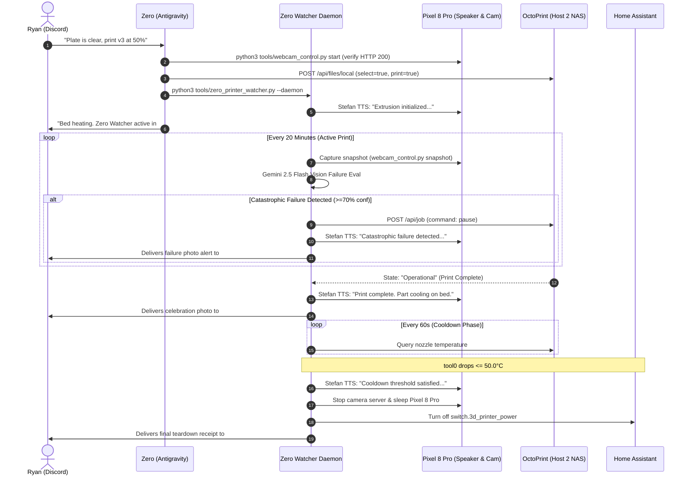

# 🖨️ Print3D-Slicer Skill (Autonomous Cloud Remeshing, OrcaSlicer & OctoPrint Dispatch)

The **Print3D-Slicer** skill governs the headless preparation, cloud-accelerated remeshing, parameter reasoning, slicing execution, and OctoPrint network dispatch for 3D models printing on the Creality Ender-3 V2.

---

## 🎯 When to Activate This Skill

Activate this skill whenever:
- Designing parametric mechanical CAD parts, enclosures, brackets, threads, or Gridfinity hardware in Python via **`build123d`** and **`bd_warehouse`** (OpenCASCADE B-Rep kernel).
- Converting an `.stl`, `.obj`, `.step`, or `.3mf` into sliced `.gcode` for the Ender-3 V2.
- Generating watertight solid meshes from raw 2D-to-3D outputs (Trellis, Meshy, Tripo3D) via Modal serverless compute.
- Offloading heavy 3D CAD transforms, voxelization, or 360° turntable rendering to cloud compute.
- Scaling models up or down while auditing physical FDM nozzle resolution limits.
- Running headless OrcaSlicer on Host 2 (`<HOST_2_IP>`).
- Extracting G-code metrics (estimated print time, filament grams, layer count, embedded thumbnail).
- Dispatching sliced files to OctoPrint and starting the autonomous Zero Printer Watcher daemon.

---

## 🛠️ Parametric Mechanical CAD Standard (`build123d` + `bd_warehouse` OpenCASCADE B-Rep)

For all functional 3D prints (enclosures, brackets, stands, snap-fit housings, threaded couplers, gears, and hardware mounts), **default to `build123d` + `bd_warehouse`** (OpenCASCADE B-Rep kernel) rather than writing manual `trimesh` vertex/polygon math:

### 1. Environment & Persistence:
- **Installed Location:** Persisted on NAS storage in `/workspace/.venv/modal` (symlinked at `/workspace/.venv/cad`) and linked globally into system `python3` via `/usr/local/lib/python3.11/dist-packages/zero_cad.pth`.
- **Core Packages:**
  - `build123d`: Analytical Boundary Representation (B-Rep) modeling (`BuildPart`, `BuildSketch`, `BuildLine`, exact topological `fillet()`, `chamfer()`, `offset()`, `loft()`, `sweep()`, and `section()`).
  - `bd_warehouse`: Parametric hardware library (`bd_warehouse.thread.IsoThread`, `bd_warehouse.fastener`, `bd_warehouse.bearing`, `bd_warehouse.gear`, `bd_warehouse.pipe`).
  - `manifold3d` + `trimesh`: Fast mesh verification, watertightness auditing, and bounding-box grounding.

### 2. Why B-Rep (`build123d`) Replaces Raw Mesh CSG for Functional Parts:
- **1-Line Topological Fillets & 45° FDM Chamfers:** Select edges topologically (`part.edges().filter_by(Axis.Z)` or `part.faces().sort_by(Axis.Z)[-1].edges()`) and apply exact `chamfer(..., length=0.8)` or `fillet(..., radius=1.5)` without manual trigonometry.
- **Dual Export (`.step` + `.stl` / `.3mf`):** Always export both the analytical B-Rep `.step` file (`export_step(part.part, "model.step")`) for CAD interchange and high-resolution `.stl` (`export_stl(part.part, "model.stl", tolerance=0.002, angular_tolerance=0.05)`) for OrcaSlicer.
- **Standard Hardware & Threads (`bd_warehouse`):** Generate true ISO metric threads (`IsoThread(major_diameter=6 * MM, pitch=1 * MM, length=10 * MM)`), counterbored M-series screw clearance holes (`CounterBoreHole`), and heat-set insert bosses directly in code.

---

## 🛑 Host Resource & Active Print Concurrency Invariants

To protect real-time USB serial streaming (`/dev/ttyUSB0` at 115200 baud) to the Ender-3 V2 and prevent Host 2 lockups, enforce these non-negotiable compute gates:

1. **Active Print Concurrency Ban:**
   - Heavy CAD operations (voxel pitch <0.30mm, marching cubes, or software mesh rendering) are strictly forbidden on Host 2 while an active print is in flight over USB serial.
   - CPU starvation on Host 2 starves the OctoPrint serial ping-pong buffer, causing the hotend to dwell on the print, melt divots into perimeters, and stall the printer.
   - All heavy mesh remeshing, boolean operations, and 3D rendering must be offloaded to Modal cloud compute.
2. **Visual Decimation Proxy Rule:**
   - Never pass raw high-density meshes (>50,000 faces) to local CPU software depth-sorting.
   - Always create a 35,000-face quadric decimation proxy (`mesh.simplify_quadric_decimation(35000)`) if generating camera previews locally.
   - Full-resolution watertight meshes stay intact on disk strictly for OrcaSlicer.
3. **Worker Priority De-Elevation:**
   - Any local slicing or lightweight transforms on Host 2 must execute with `nice -n 19 ionice -c 3` inside Docker to guarantee CPU priority to real-time OctoPrint daemons.

---

## ☁️ Modal Serverless Cloud Compute Pipeline

Heavy CAD geometry generation, multi-mesh Boolean unions, voxel remeshing, and turntable rendering run serverlessly on Modal to keep Host 2 completely unloaded:

### Configuration & Environment:
- **Modal Profile:** `ryanbrock2011` configured via `/root/.modal.toml` and `/workspace/.env`.
- **Dedicated Virtual Environment:** `/workspace/.venv/modal/` (isolated from global container Python).
- **Execution Pattern:**
  ```bash
  /workspace/.venv/modal/bin/modal run /workspace/tools/modal_v3_builder.py
  /workspace/.venv/modal/bin/modal run /workspace/tools/modal_render_3d.py
  ```

### Cloud Tooling Architecture (Headless Blender 4.2 `bpy` + OpenVDB + Cycles):
1. **`tools/modal_v3_builder.py`:**
   - Runs headless **Blender 4.2 (`bpy==4.2.0`)** on an 8-vCPU, 16GB RAM Modal cloud container.
   - Executes native **OpenVDB Voxel Remeshing** (`REMESH` modifier in `VOXEL` mode, ~0.4s execution) instead of slow CPU numpy Marching Cubes.
   - Applies volume-preserving **Corrective Smooth** (`CORRECTIVE_SMOOTH` with `use_only_smooth=True` and `use_pin_boundary=True`) to eliminate voxel stepping while retaining crisp mechanical creases and edges.
   - Triangulates (`TRIANGULATE`), verifies manifold watertightness and $Z=0$ grounding via `trimesh`, and exports the monolithic STL to `/workspace/data/3dprint/`.
2. **`tools/modal_render_3d.py`:**
   - Renders path-traced 24-frame, 360° studio turntables using **Blender Cycles** (`CYCLES` engine with adaptive sampling).
   - Features a physical 3-point Area Light studio rig (warm Key, cool Fill, crisp Rim), Principled BSDF clay/sculpt shaders, ambient occlusion, and a matte ground plane that catches real contact shadows.
   - Automatically scales camera distance and area light wattage to any single part or multi-part assembly bounding box in true 1:1:1 proportion, delivering optimized GIF turntables directly to Discord.

---

## 📏 Miniature & Figurine Downscaling Protocol

When scaling down full-size models (e.g. 50% scale from 120.0mm down to 60.0mm height):

1. **Uniform Scaling & Grounding:**
   - Scale mesh coordinates uniformly: `mesh.apply_scale(0.50)`.
   - Re-ground bottom boundary strictly to `Z = 0.0`:
     ```python
     mesh.apply_translation([0, 0, -mesh.bounds[0][2]])
     ```
2. **The 0.4mm Nozzle Feature Rule:**
   - A standard 0.4mm brass nozzle produces 0.40–0.45mm perimeter line widths.
   - Minimum self-supporting feature thickness is 2 perimeters (0.80mm).
   - Scaling a model to 50% cuts all physical wall thicknesses in half. Any concept feature originally 1.2mm becomes 0.60mm, which cannot resolve cleanly and breaks during support removal.
   - Ensure concept sculpts enforce $\ge 1.6\text{mm}$ feature thickness if intended for 50% downscaling.
3. **Infill & Shell Adjustments for Scaled Prints:**
   - Scaled miniatures lose internal volume faster than surface area ($V \propto s^3$).
   - Increase gyroid infill to 12%–15% to maintain structural core rigidity for small leg and neck cross-sections.
   - Maintain 3 outer perimeter walls (`wall_loops = 3`) to ensure perimeter strength.

---

## ⚙️ Slicing Execution Engine (OrcaSlicer on Host 2)

OrcaSlicer runs headlessly inside Docker on Host 2 (`<HOST_2_IP>`):

### 1. Slicing Command Pattern:
```bash
nice -n 19 sudo docker exec orcaslicer /opt/orcaslicer/bin/orca-slicer \
  --load-settings "/prints/my_machine.json;/prints/zero_figurine_process.json" \
  --load-filaments "/prints/my_filament.json" \
  --slice 0 \
  --outputdir /prints \
  /prints/model.stl
```

### 2. Autonomous Slicing Parameter Profiles:

| Model Archetype | Layer Height | Walls | Infill Type & % | Support Strategy |
|---|---|---|---|---|
| **Miniature / Figurine / Sculpt** | `0.16mm` | 3 | Gyroid 12%–15% | **Option C: Easy-Snap Tree Slim** (`tree(auto)` + `tree_slim`, 25° threshold) |
| **Functional Bracket / Stand / Case** | `0.20mm` | 3–5 | Gyroid 15%–40% | **Option A: None** (Default CAD split/chamfers) → **Option B: Normal Snug** (`normal(auto)` + `snug` if unavoidable overhang) |
| **Rapid Prototype / Fit Test** | `0.28mm` | 2 | Gyroid 10% | **None** |

### Key FDM Rules for Ender-3 V2:
1. **Always Use Gyroid Infill:** Linear infills (Grid, Triangle) cross over previously printed paths on the same layer, causing nozzle clicks that knock delicate miniatures off the bed. Gyroid infill never crosses itself.
2. **Zero-Brim & Ban on Rafts (Textured PEI Bed):**
   - The textured PEI spring steel build plate provides massive mechanical and thermal adhesion for PETG/PLA at 60°C bed temperature.
   - **Rafts & Auto-Brims are Strictly Banned (`raft_layers = 0`, `brim_type = no_brim`, `brim_width = 0`):** Always explicitly set `brim_type = "no_brim"`, `tree_support_auto_brim = "0"`, `tree_support_brim_width = "0"`, and `support_object_first_layer_gap = "1.0"` so OrcaSlicer never sneaks a 3–5mm first-layer brim flange around the model or support trunks.
   - **Detached Purge Skirt Only:** Use `skirt_loops = 1` with `skirt_distance = 3–4mm` strictly to prime the nozzle and purge stale plastic.
3. **Support Hierarchy (Functional vs. Organic/Figurine):**
   - **Functional Parts:** Default to **Option A (100% Support-Free CAD)** via flat `Z = 0.0` splits, 45° chamfers, and crowned bridge arches. If a functional part has an unavoidable flat overhang, use **Option B (`support_type = "normal(auto)"`, `support_style = "snug"`)** so the support column pops off in a single block without wrapping branches around the part.
   - **Miniatures & Organic Sculpts (Option C — Easy-Snap Tree Slim):**
     - **Style (`support_type = "tree(auto)"`, `support_style = "tree_slim"`):** Slim trunks (`tree_support_branch_diameter = 2.5mm`, `tree_support_tip_diameter = 0.6mm`) prevent giant merged logs and break away at pinpoint tips.
     - **Top/Bottom Z-Distance (`support_top_z_distance = 0.28mm`, `support_bottom_z_distance = 0.28mm`):** Establishes a clean thermal separation gap so supports snap off cleanly with zero scarring.
     - **Single-Wall Tree Trunks (`tree_support_wall_count = 1`):** Single perimeter wall makes branches brittle so they crush and snap off effortlessly with finger pressure.
     - **XY Wall & First-Layer Clearance (`support_object_xy_distance = 0.60mm`, `support_object_first_layer_gap = 1.0mm`):** Prevents growing vertical tree trunks or first-layer pads from fusing into the model.
     - **Sparse 1-Layer Interface (`support_interface_top_layers = 1`, `support_interface_spacing = 0.80mm`):** Replaces dense welded interface pads with sparse contact points.
4. **Bed Contact Stability:** Verify the bottom plane is completely flat at $Z = 0.0$. If a miniature base is slightly domed, apply planar bisecting or translation so the first layer has solid surface area.

---

## 📸 3D CAD Preview & Build Plate Visualization Standards

Whenever generating 3D renders, build plate previews, or layout visualizations:

1. **Strict Ban on `matplotlib` `Poly3DCollection` for 3D Mesh Rendering (Painter's Algorithm Defect):**
   - **NEVER use `matplotlib` `Poly3DCollection` to render 3D STL/CAD meshes.**
   - `Poly3DCollection` has no per-pixel depth buffer (Z-buffer); it sorts whole triangles by their average centroid depth (Painter's Algorithm). On Boolean CSG meshes (`manifold3d` / `trimesh`), long diagonal triangles on flat outer bezels sort behind smaller internal cavity triangles, causing internal faces to bleed through outer walls as jagged diagonal shards.
   - **Primary Standard — Headless Blender 4.2 (`bpy` + Cycles) on Modal (`tools/modal_render_3d.py`):**
     - Offload 3D CAD previews, multi-part assembly renders, build-plate layouts, and 360° turntables to headless **Blender 4.2 Cycles** on Modal.
     - For mechanical/hard-surface CAD parts, always apply an `EDGE_SPLIT` modifier (`split_angle = math.radians(32.0)`) or `shade_auto_smooth` so flat walls remain razor-sharp while cylindrical bores and fillets render smoothly.
   - **Secondary Local Fallback — True Per-Pixel Barycentric Z-Buffer (`/workspace/gotchi/cad/render_labeled.py`):**
     - If generating annotated 2D/3D orthographic diagrams locally without matplotlib 3D collections, use a true per-pixel barycentric Z-buffer with back-face culling and 2× SSAA (`rasterize_scene_zbuffer`), never `Poly3DCollection`.

2. **Mandatory Real-World 1:1:1 Aspect Ratio Invariant:**
   - All renders (Blender camera framing or orthographic projections) must preserve true 1:1:1 physical proportions so squat enclosures are never stretched vertically.

3. **Strict Ban on Naive Index-Strided Face Subsampling (`faces[::N]`):**
   - **NEVER** downsample triangular meshes by taking arbitrary stride slices of the face index array (`faces[::3]`, `faces[::4]`), which destroys manifold topology.

4. **Dual-View Preview Standard (Assembled Product + Build Plate Layout):**
   - Functional prints often require parts to be inverted or oriented sideways on the build plate to print cleanly.
   - Whenever staging a multi-part functional model, generate **both**:
     1. **Assembled Form Preview:** Shows the parts mated in their final upright configuration (with distinct materials/colors per component) under 3-point studio area lighting.
     2. **Accurate Plate Layout Preview:** Shows the parts oriented on the 220×220 mm bed in true 1:1:1 physical proportion.

---

## 🌐 OctoPrint REST API Dispatch & Dual-Tier Execution

### Method A: Host-Streaming (Fast Local Dispatch)
Used for standard prints (<4 hours):
```bash
curl -s -X POST \
  -H "X-Api-Key: ${OCTOPRINT_API_KEY}" \
  -F "file=@/workspace/data/3dprint/job.gcode" \
  -F "select=true" \
  -F "print=true" \
  "http://<HOST_2_IP>:8888/api/files/local"
```

### Method B: Host-Crash-Immune SD Card Dispatch
Used for long multi-hour prints (>4 hours) where host container reboots or network interruptions must never affect the physical print:
```bash
curl -s -X POST \
  -H "X-Api-Key: ${OCTOPRINT_API_KEY}" \
  -F "file=@/workspace/data/3dprint/job.gcode" \
  -F "select=true" \
  -F "print=true" \
  "http://<HOST_2_IP>:8888/api/files/sdcard"
```

---

## ⏸️ Configured OctoPrint Safe Pause & Resume Hooks

To eliminate nozzle burn divots and prevent bed adhesion loss during intentional pauses (filament changes, nozzle checks, or automated watcher pauses), OctoPrint is configured with these persistent G-code scripts in `/api/settings`:

- **After print job is paused (`afterPrintPaused`):**
  ```gcode
  ; --- Safe Pause Routine ---
  
  M83 ; relative extrusion
  G1 E-2.5 F3000 ; retract 2.5mm to eliminate oozing
  G91 ; relative coordinates
  G1 Z10 F1200 ; lift nozzle 10mm clear of model
  G90 ; absolute coordinates
  G1 X10 Y10 F6000 ; park in front-left corner
  ; Bed heater remains at target 60°C to preserve adhesion
  
  ```

- **Before print job is resumed (`beforePrintResumed`):**
  ```gcode
  ; --- Safe Resume Routine ---
  
  
  M109 S{{ pause_temperature[0].target }} ; re-verify hotend temperature
  
  G90 ; absolute coordinates
  G1 X{{ pause_position.x }} Y{{ pause_position.y }} F6000 ; return to XY first
  G1 Z{{ pause_position.z }} F1200 ; descend to pause layer height
  M83 ; relative extrusion
  G1 E2.5 F1500 ; prime 2.5mm
  G90 ; restore absolute positioning
  
  ```

---

## 📹 Autonomous IP Webcam Lifecycle (Pixel 8 Pro)

The dedicated monitoring camera (Pixel 8 Pro running IP Webcam) is managed over ADB via `/workspace/tools/webcam_control.py`:

### 1. Mandatory Pre-Flight Camera Initialization:
Zero and the watcher daemon MUST actively bring the camera online before requesting snapshots or starting vision evaluations:
```bash
python3 /workspace/tools/webcam_control.py start
```
- **Wakes Device & Dismisses Lock:** Sends `KEYCODE_WAKEUP` and `wm dismiss-keyguard` over ADB.
- **Launches IP Webcam Activity:** Opens `com.pas.webcam/.Configuration`, scrolls, and taps `Start Server`.
- **Preserves OLED Display:** Dims screen brightness to 0.
- **High-Speed ADB Port Forwarding:** Establishes `adb forward tcp:3333 tcp:3333` across the active transport (USB via Host 2 `<HOST_2_IP>:5037` or Wi-Fi).
- **Endpoint Verification:** Polls `http://127.0.0.1:3333/status.json` to confirm the server is live and returning 200 OK before proceeding.

### 2. Camera Controls & Stale Image Immunity:
- **Start Camera:** `python3 /workspace/tools/webcam_control.py start` (brings camera online, verifies HTTP port).
- **Snapshot:** `python3 /workspace/tools/webcam_control.py snapshot --output /workspace/data/3dprint/snap.jpg` (pulls `/shot.jpg` and rotates 270°).
  - *Stale Disk Invariant:* Callers MUST delete the target snapshot path before capture.
  - *Strict Exit Code:* `snapshot` exits with `1` if frame acquisition fails, preventing downstream tools from reading dead buffers.
- **Stop Camera:** `python3 /workspace/tools/webcam_control.py stop` (force-stops app, closes port 3333, puts screen to sleep).

---

## 🛡️ Autonomous Watcher & Safe Teardown (`tools/zero_printer_watcher.py`)

Whenever a print begins, spin up the Zero Printer Watcher daemon detached:
```bash
python3 /workspace/tools/zero_printer_watcher.py --daemon
```

### Daemon Architecture:
1. **Pre-Flight Camera Boot:** Calls `webcam_control.py start` upon daemon startup to ensure the camera server is actively broadcasting before print monitoring loops begin.
2. **Option B Auto-Pause:** Evaluates snapshots every 20 minutes via Gemini 2.5 Flash vision. If catastrophic failure (spaghetti, detachment, bed drag) is detected with $\ge 70\%$ confidence:
   - Immediately calls OctoPrint's `/api/job` `pause` command.
   - Dispatches urgent spoken audio alert via Stefan profile: `"Catastrophic failure detected on {clean_name}. Print paused to prevent damage."`
   - Delivers urgent photo alert to `#3d-print` (`1555973316752449576`).
3. **Capture Failure Graceful Degradation:** If `capture_webcam_snapshot` fails (camera asleep or offline), the watcher logs a warning and skips the vision evaluation cycle. It NEVER evaluates stale images and NEVER pauses an active print solely due to camera network dropouts.
4. **Nominal Progress Receipts:** Delivers clean progress checks with hotend temperatures and vision confidence to `#3d-print`.
5. **Dynamic Dual-Cadence Teardown:**
   - Upon `PrintDone`, `PrintCancelled`, or `PrintFailed`, shifts polling cadence to 60 seconds.
   - Dispatches completion announcement: `"Print complete for {clean_name}. Part cooling on bed. Do not touch."`
   - Waits until the nozzle cools below 50.0°C to prevent heat creep.
   - Dispatches teardown announcement: `"Cooldown threshold satisfied. Cutting main power now."`
   - Stops IP Webcam on the Pixel 8 Pro via ADB.
   - Turns off `switch.3d_printer_power` via Home Assistant REST API.
   - Posts final teardown receipt to `#3d-print` and exits cleanly.

---

## 🔊 Physical Audio Announcement Architecture (`tools/phone_speech.py`)

Physical voice announcements broadcast into the 3D printer room directly through the Pixel 8 Pro's hardware speaker via neural TTS and ADB:

### Voice Profile & Synthesis:
- **TTS Engine:** Microsoft Edge TTS (`edge-tts`).
- **Profile:** Stefan (Ultron persona) — `en-US-SteffanNeural` (`-5Hz` pitch, `-5%` rate, volume: 21).
- **Transport Pipeline:** Synthesizes `.mp3` to `/workspace/scratch/audio/`, pushes to `/sdcard/Notifications/zero_announcement.mp3` over ADB, sets media stream volume to 21, wakes device, and triggers playback via Android `PreviewActivity`.

### 4 Audio Lifecycle Milestones:
1. **Extrusion Start (Initial Kick-Off):**
   `"Extrusion initialized for {clean_name}. Keep your hands off the build plate."`
   - Fires once when print first transitions to `Printing` ($Z \le 5.0\%$).
2. **Catastrophic Failure Auto-Pause (Option B):**
   `"Catastrophic failure detected on {clean_name}. Print paused to prevent damage."`
   - Fires synchronously before OctoPrint pause to alert nearby operators immediately.
3. **Print Complete (100% Cooldown Entrance):**
   `"Print complete for {clean_name}. Part cooling on bed. Do not touch."`
   - Fires immediately upon `PrintDone` while fans run to cool the hotend.
4. **Mains Cut & Safe Teardown:**
   `"Cooldown threshold satisfied. Cutting main power now."`
   - Fires right before cutting `switch.3d_printer_power` via Home Assistant.

---

## 🔄 End-to-End Discord Autonomous Lifecycle


        Watcher->>Octo: Query nozzle temperature
    end
    Note over Watcher,HA: tool0 drops <= 50.0°C
    Watcher->>Cam: Stop camera server & sleep Pixel 8 Pro
    Watcher->>HA: Turn off switch.3d_printer_power
    Watcher->>Ryan: Delivers final teardown receipt to #3d-print
```

