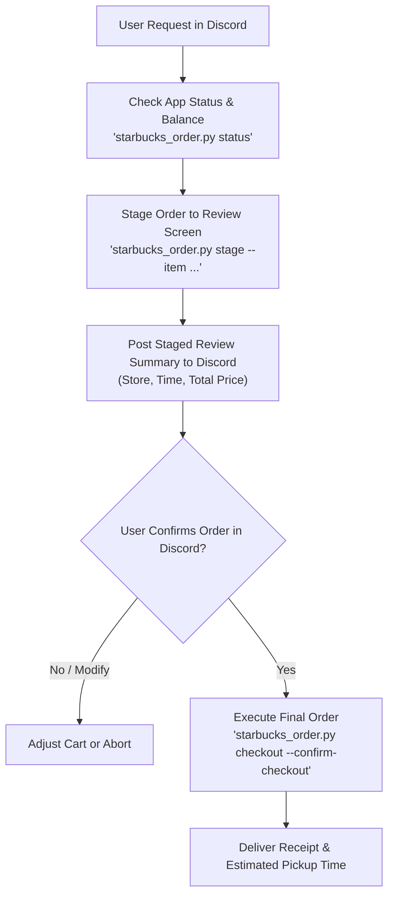

# ☕ Starbucks Native Android Ordering Skill (Pixel 8 Pro)

## Overview
The `starbucks-order` skill automates mobile ordering through the official authenticated **Starbucks Android App** (`com.starbucks.mobilecard`) on the physical **Google Pixel 8 Pro** (`husky`) tethered to Host 2 via ADB UI Automator.

It provides end-to-end automation for checking Starbucks Card balance and Star rewards, listing favorite and previous orders, searching the beverage and food menu, selecting pickup stores, and staging items into the bag with full order review summaries (subtotal, tax, estimated pickup window).

---

## 🛡️ Mandatory Safety Invariants & Guardrails

1. **Always Confirm Pickup Location First & Require Explicit Approval Before Ordering:**
   - Pickup store locations are **dynamic** (depending on whether Ryan is at home, running errands, or heading to Sunday morning swim lessons).
   - Zero **MUST ALWAYS** confirm the target Starbucks store location first before staging/placing an order. Never assume a static default store.
   - The CLI and skill **MUST NEVER** execute checkout without prior explicit, interactive confirmation from Ryan in Discord.
   - When requested to order Starbucks, Zero **MUST** confirm the store location, run `stage` to assemble the cart, and present the staged review summary:
     - Target Store & Address
     - Estimated Pickup Window
     - Item & Customizations
     - Subtotal, Tax, and Total Price
     - Payment Method / Card Balance
   - Zero must wait for explicit approval from Ryan before executing `checkout --confirm-checkout`.

2. **Known Household Orders & Presets:**
   - **Ryan's Go-To Custom Drink:** **Grande Caffè Americano** in a **Venti Cup** with **3/4" splash of Heavy Cream** and **2 packets of Honey** (or **3 pumps Honey Blend Syrup** in saved Favorites).
   - **Sunday Morning Pre-Swim Lesson Go-To Order (~8:40 AM PT):** Ryan's custom **Grande Caffè Americano** (in a Venti cup, 3/4" splash of Heavy Cream, 2 packets of Honey) + **Pumpkin & Pepita Loaf**.
   - **Ordering with Emily:** Emily's most common recent drink is a **Grande Cinnamon Dolce Latte** (ordered Oct 20 & Oct 16, and saved in Favorites), with occasional seasonal/vanilla alternates (**Grande Pecan Crunch Latte** on Sep 25, **Grande Iced Pecan Crunch Latte** on Oct 3, **Grande Caffè Latte** on Aug 30, and **Grande Starbucks Blonde Vanilla Latte** in Favorites). Pickup location is always dynamic.

2. **3D Printer Conflict Guard:**
   - The tethered Pixel 8 Pro also serves as the print bed webcam monitor for OctoPrint (port 3333).
   - Before interacting with the device, the CLI verifies `check_printer_conflict()`. If an active print monitoring session is detected, the operation aborts immediately unless `--force` is explicitly provided.

3. **OLED Panel & Battery Preservation:**
   - All operations are wrapped in the `starbucks_session()` context manager.
   - The display is woken and unlocked on entry (`KEYCODE_WAKEUP` + `KEYCODE_MENU`) and **unconditionally put back to sleep** (`KEYCODE_POWER = 26`) in a `finally:` block.

4. **Zero Hardcoded Credentials & Topology:**
   - Never hardcode login credentials, private IPs, or card details.
   - Credentials (`STARBUCKS_EMAIL`, `STARBUCKS_PASSWORD`) are loaded dynamically from `/secrets/env.json` only if an unauthenticated session requires re-login.

---

## 🛠️ CLI Reference (`tools/starbucks_order.py`)

```bash
# Check app status, reward stars, card balance, and active store
python3 tools/starbucks_order.py status [--json]

# List nearby stores (and optionally select one)
python3 tools/starbucks_order.py stores [--select "Store Name"] [--json]

# List favorites and recent orders from the Order tab
python3 tools/starbucks_order.py favorites [--json]

# Search the menu for items
python3 tools/starbucks_order.py search "<query>" [--json]

# Stage an order in the cart (stops strictly at Order Review screen)
python3 tools/starbucks_order.py stage --item "<Item Name>" [--store "<Store Name>"] [--json]

# Finalize order and charge payment (MANDATORY CONFIRMATION REQUIRED)
python3 tools/starbucks_order.py checkout --confirm-checkout [--json]
```

---

## 📋 Standard Workflow



### Example Staged Discord Receipt Prompt
> **Staged Starbucks Order Review**
> - **Item:** Iced Brown Sugar Oatmilk Shaken Espresso (Grande)
> - **Store:** Stevens Creek & Winchester
> - **Estimated Pickup:** 5–8 mins
> - **Subtotal:** $5.95
> - **Tax:** $0.55
> - **Total:** $6.50 (Starbucks Card balance: $18.50)
> 
> *Order is staged in the mobile bag. Please confirm if you would like me to place the order.*
